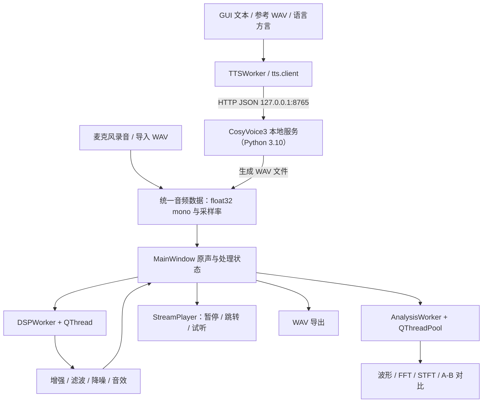
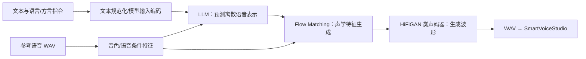

# SmartVoiceStudio

**智能人声音效台 · Digital Signal Processing & Offline Multilingual TTS**

**版本：V0.11.1 ｜ 平台：Windows 10/11 ｜ GUI：Python 3.12 + PySide6 ｜ 本地 TTS：Python 3.10 + CosyVoice 3**

[项目仓库](https://github.com/Qing3019/SmartVoiceStudio) · [CosyVoice 官方源码](https://github.com/FunAudioLLM/CosyVoice) · [Spotify Pedalboard](https://spotify.github.io/pedalboard/)

SmartVoiceStudio 是一款面向数字信号处理课程实践的 Windows 桌面语音工作台，整合了麦克风采集、WAV 管理、FFT/STFT 可视化、频谱减法去噪、音频增强、EQ、声音特效与 **CosyVoice 3 本机离线多语言/方言文字转语音（TTS）**。生成的 TTS 音频可以直接进入已有的 DSP 编辑、试听和导出链路。

> **项目范围**：本项目以 **CosyVoice 3 TTS 集成**为最终开发目标，不实现 CNN 深度学习语音增强或自行训练 TTS 模型。这里的“完成”指功能链路在源码中已集成、主要算法及接口具备测试；不等于已验证每台 Windows 电脑上的驱动、性能或 EXE 分发。当前推理方案以 CPU 运行，未完成 Intel Arc XPU 专项加速。
>
> **文档结构**：第一章为系统架构、源码目录、安装运行、使用教程与发布验收；第二章按实验要求说明采集与分析、增强、降噪、五种音效预设、六种高级音效和 TTS 的数学原理及实际代码路径。每处默认参数均以整理后的 V0.11.1 文件为准。

---


## 第一章 · 工程架构与使用说明

### 1.1 项目背景与功能概览

SmartVoiceStudio 面向数字信号处理与智能语音技术的综合实践，提供从“**声音获取 → 信号分析 → 数字处理 → 效果试听 → 音频输出**”的完整工作链路，并将本地 CosyVoice 3 文字转语音（Text-to-Speech，TTS）作为新的音频输入来源。

| 业务模块 | 主要能力 | 完成情况 |
| --- | --- | --- |
| 音频采集与管理 | 麦克风录音、设备选择、WAV 读写、单声道处理 | 已实现 |
| 播放控制 | 原声/处理后/指定版本试听、暂停、继续、停止、进度跳转 | 已实现 |
| 时频分析 | 时域波形、FFT 幅频谱、STFT 语谱图、前后对比 | 已实现 |
| 基础增强 | 线性增益、峰值归一化、低通/高通/带通 Butterworth 滤波 | 已实现 |
| 传统去噪 | 基于噪声频谱估计的谱减法及幅度谱底约束 | 已实现 |
| 常用声音效果 | 三段 EQ、延迟回声、变速、变调、五种人声预设 | 已实现 |
| 高级数字音效 | 混响、机械电音、合唱、压缩、位深量化、空间复合 | 已实现 |
| 智能语音合成 | CosyVoice 3 普通话零样本、跨语言、方言/风格指令 | 已集成；效果受模型与输入影响 |

#### 1.1.1 技术栈

- **主应用**：Python 3.12、PySide6、pyqtgraph、NumPy、SciPy、Librosa、SoundDevice、SoundFile、Pedalboard。
- **离线 TTS 运行时**：单独的 Python 3.10 Conda 环境、CosyVoice 官方源码、`Fun-CosyVoice3-0.5B-2512` 模型及其依赖。
- **进程间通信**：本机 HTTP/JSON 服务，默认地址为 `http://127.0.0.1:8765`；合成 WAV 由本机文件路径交接。
- **分发方式**：PyInstaller 负责 GUI/DSP 的 Windows EXE；CosyVoice 推理服务和模型文件仍单独部署。一键启动器协调两者。

> 本工程实际使用 **PySide6**，与最初课程指导书示例中的 PyQt5 不完全相同，但二者都基于 Qt 的信号/槽、控件和事件循环机制。

### 1.2 总体系统架构



架构的核心思想是**分离职责**：GUI 不直接实现滤波、频谱减法或神经网络；DSP 函数只负责输入音频到输出音频的计算；耗时计算由工作线程处理；TTS 运行在独立进程，避免复杂的机器学习依赖与 GUI 环境冲突。

#### 1.2.1 两个 Python 环境为什么必须分开？

GUI 需要快速启动并稳定响应用户操作，而 CosyVoice 涉及 PyTorch、ONNX、参考语音特征提取和较大的模型权重。将两个环境隔离可降低依赖版本冲突，也方便分别更新桌面功能和模型。**本地运行 TTS 无须云端合成 API**，但首次获取源码、依赖和权重仍需要联网。

#### 1.2.2 音频的统一数据约定

| 项目 | 当前约定 |
| --- | --- |
| 内部数据 | `numpy.ndarray`，单声道、一维、`float32` |
| 采样率 | 每段音频携带自己的 `sample_rate`，**不强制统一** |
| 常规录音配置 | `config.py` 默认 `44100 Hz`，实际流录音优先参考选中设备的默认采样率 |
| CosyVoice 输出 | 当前官方模型典型输出 `24000 Hz`，以返回结果为准 |
| WAV 导入 | `soundfile` 读入；立体声以各声道算术平均转单声道 |
| WAV 导出 | 峰值不超出 `±1` 时默认 PCM 16-bit；超幅时使用 32-bit 浮点 WAV，避免导出时静默削波 |
| 后台计算 | DSP 使用 `QThread`；FFT/STFT 使用 `QThreadPool`；TTS 通过 HTTP 请求使用独立工作线程 |

### 1.3 工程目录与关键文件职责

以下目录以当前 V0.11.1 整理版为准。`CosyVoice` 官方仓库、模型权重、Conda 环境、`dist/`、运行日志及用户录音均**不应作为普通源码提交到 GitHub**。

```text
SmartVoiceStudio/
├── main.py                      # PySide6 应用入口、统一界面主题
├── app_version.py               # APP_NAME / APP_VERSION / APP_TITLE
├── config.py                    # 采样率、FFT参数、运行数据路径
├── requirements.txt             # GUI 主环境运行依赖
├── requirements-dev.txt         # GUI 运行依赖 + 测试/打包工具
├── SmartVoiceStudio.spec        # PyInstaller GUI 构建配置
├── launch_smartvoice.py         # TTS 服务与 GUI 的一键启动协调
├── start_smartvoice.cmd         # Windows 双击启动入口
├── launcher_config.example.json # 本机环境路径配置模板
├── scripts/
│   └── build_gui.ps1            # PowerShell GUI 打包命令
├── audio/
│   ├── devices.py               # 输入输出声卡枚举、设备采样率
│   ├── recorder.py              # StreamRecorder 麦克风流录音
│   ├── player.py                # StreamPlayer 可暂停/跳转播放
│   └── wav_io.py                # WAV 载入和保存
├── dsp/
│   ├── analysis.py              # 正式GUI的波形/FFT/STFT计算及降采样
│   ├── fft.py                   # 教学Demo等可复用的FFT接口
│   ├── stft.py                  # 教学Demo等可复用的STFT接口
│   ├── enhance.py               # 增益、峰值归一化、加白噪声
│   ├── filter.py                # Butterworth低通、高通、带通
│   ├── denoise.py               # 谱减法语音去噪
│   ├── equalizer.py             # Biquad三段EQ
│   ├── effects.py               # 五种预设、回声、变速、变调
│   └── advanced_effects.py      # 六种Pedalboard/NumPy高级音效
├── gui/
│   ├── main_window.py           # 主窗口、音频状态、按钮路由、版本/撤销
│   ├── control_panel.py         # 增益、滤波、降噪控制面板
│   ├── effects_panel.py         # 预设音效、EQ、回声、变速变调
│   ├── advanced_effects_panel.py # 六种高级音效参数面板
│   ├── tts_panel.py             # TTS文本、语言、方言、参考录音
│   ├── collapsible_section.py   # 左侧折叠区控件
│   ├── plot_panel.py            # 波形/FFT/STFT与分析缓存
│   ├── analysis_worker.py       # 后台时频计算任务
│   └── workers.py               # DSPWorker异步处理任务
├── tts/
│   ├── client.py                # /health、/synthesize HTTP客户端
│   ├── worker.py                # TTSWorker线程任务与信号
│   └── local_server.py          # 加载CosyVoice3模型、本机推理服务
├── demo/                        # 各开发阶段教学与验证脚本
├── tests/                       # DSP、HTTP协议、GUI、启动器测试
├── data/recordings/             # 录音文件（运行时产生）
├── results/                     # 音效、合成WAV（运行时产生）
└── runtime_logs/                # 本机服务日志（运行时产生）
```

#### 1.3.1 关键函数与调用关系

| 功能 | 实际入口或关键函数 | 文件 |
| --- | --- | --- |
| 初始化 GUI | `main()` / `MainWindow.init_ui()` | `main.py` / `gui/main_window.py` |
| 音频载入 | `load_audio()` → `MainWindow.load_audio_data()` | `audio/wav_io.py` / `gui/main_window.py` |
| 开始与停止录音 | `StreamRecorder.start()` / `.stop()` | `audio/recorder.py` |
| 播放/暂停/定位 | `StreamPlayer.start()` / `.pause()` / `.resume()` / `.seek()` | `audio/player.py` |
| 处理调度 | `MainWindow.apply_processing()` → `DSPWorker.run()` | `gui/main_window.py` / `gui/workers.py` |
| 频谱分析 | `analyze_audio()` → `AnalysisWorker` → `AudioAnalysisPanel` | `dsp/analysis.py` / `gui/analysis_worker.py` / `gui/plot_panel.py` |
| 去噪 | `spectral_subtraction()` | `dsp/denoise.py` |
| 三段 EQ | `three_band_eq()` | `dsp/equalizer.py` |
| 常用人声预设 | `apply_preset()` | `dsp/effects.py` |
| 高级音效 | `apply_advanced_effect()` | `dsp/advanced_effects.py` |
| TTS 参数与策略 | `TTSPanel.parameters()` / `prepare_inference()` | `gui/tts_panel.py` / `tts/local_server.py` |
| TTS 服务请求 | `synthesize()` → `/synthesize` | `tts/client.py` / `tts/local_server.py` |
| TTS 完成回填 | `TTSWorker` → `on_tts_completed()` → `load_audio_data()` | `tts/worker.py` / `gui/main_window.py` |
| 版本管理 | `undo_stack`、`version_snapshots`、`reset_processing()` | `gui/main_window.py` |

### 1.4 安装与运行

#### 1.4.1 运行条件

- Windows 10/11；可以访问的麦克风和输出音频设备。
- Anaconda/Miniconda；主应用 Python 3.12，CosyVoice Python 3.10。
- 已按 [CosyVoice 官方项目](https://github.com/FunAudioLLM/CosyVoice) 下载源码及 `FunAudioLLM/Fun-CosyVoice3-0.5B-2512` 权重。
- 当前项目默认采用 **CPU 推理**。Intel Arc Graphics 并不等于 NVIDIA CUDA，且本工程没有保证 XPU 推理兼容。
- 为保证本机语音克隆的合法性，请仅使用本人或已获许可的参考录音。

本项目开发机示例路径：

```text
E:\SmartVoiceStudio\
E:\CosyVoiceRuntime\CosyVoice\
E:\CosyVoiceRuntime\CosyVoice\pretrained_models\Fun-CosyVoice3-0.5B\
D:\Anaconda\envs_dir\SmartVoiceStudio\python.exe
D:\Anaconda\envs_dir\cosyvoice3\python.exe
```

> 以上是**示例本机路径，不是通用路径**。不要直接把这些硬编码路径作为跨电脑发行方案；使用 `launcher_config.json` 调整。

#### 1.4.2 安装 GUI 环境

在项目根目录的 PowerShell 中执行：

```powershell
conda create -n SmartVoiceStudio python=3.12 -y
conda activate SmartVoiceStudio
cd E:\SmartVoiceStudio
python -m pip install -r requirements.txt
```

若环境已创建并配置成功，无须重新创建。测试与构建工具可使用：

```powershell
python -m pip install -r requirements-dev.txt
python -m pytest tests -q
```

**不要在 GUI 环境里安装 CosyVoice 官方完整依赖**；CosyVoice 使用独立的 `cosyvoice3` 环境。

#### 1.4.3 CosyVoice 3 模型与服务

官方源码和模型文件示例：

```powershell
cd E:\CosyVoiceRuntime
# 首次部署时执行；已有仓库则跳过
# git clone --recursive https://github.com/FunAudioLLM/CosyVoice.git
conda activate cosyvoice3
cd E:\CosyVoiceRuntime\CosyVoice
python -m pip install -r requirements.txt
```

模型文件应位于 `...\pretrained_models\Fun-CosyVoice3-0.5B`，包含 `cosyvoice3.yaml`、`llm.pt`、`flow.pt`、`hift.pt`、`campplus.onnx`、`speech_tokenizer_v3.onnx` 等。下载模型可参考官方 README/ModelScope；**依赖安装成功不代表权重已经下载**。

独立启动服务（使用 `cosyvoice3` 环境）：

```powershell
conda activate cosyvoice3
cd E:\SmartVoiceStudio
python -u -m tts.local_server --repo E:\CosyVoiceRuntime\CosyVoice --model E:\CosyVoiceRuntime\CosyVoice\pretrained_models\Fun-CosyVoice3-0.5B
```

在另一个终端验证：

```powershell
Invoke-RestMethod http://127.0.0.1:8765/health
```

预期响应包含 `ok: True`、`model: CosyVoice3`。**健康检查只能验证服务就绪，不等价于某段真实文本合成成功**。在主应用中仍须执行试听验证。

#### 1.4.4 一键启动（推荐）

第一次使用或迁移电脑时：

```powershell
conda activate SmartVoiceStudio
cd E:\SmartVoiceStudio
Copy-Item launcher_config.example.json launcher_config.json
# 根据本机路径修改 launcher_config.json
python launch_smartvoice.py --doctor
```

双击 `start_smartvoice.cmd`，或运行：

```powershell
.\start_smartvoice.cmd
```

启动器按顺序检查运行路径、启动本地 TTS 服务、等待 `/health` 就绪、打开 GUI。**默认启动当前源代码，不会误打开旧版 `dist` 中的 EXE**。GUI 关闭后，启动器只结束自己创建的服务，不关闭事先已运行的 CosyVoice 服务。

测试打包版 GUI 时，明确加上：

```powershell
.\start_smartvoice.cmd --exe
```

如需手动只启动 GUI（不负责启动模型）：

```powershell
conda activate SmartVoiceStudio
cd E:\SmartVoiceStudio
python main.py
```

此时普通 DSP 可直接使用；TTS 必须先有相应的本机服务。

#### 1.4.5 PyInstaller 打包

```powershell
conda activate SmartVoiceStudio
cd E:\SmartVoiceStudio
powershell -ExecutionPolicy Bypass -File .\scripts\build_gui.ps1
```

成功后生成 `dist\SmartVoiceStudio\SmartVoiceStudio.exe`，再使用 `start_smartvoice.cmd --exe` 联合启动。这里打包的是 **GUI/DSP 部分**，不包含完整 CosyVoice3 模型和独立 Conda 环境，暂不能称为“复制一个 EXE 就可在任意电脑完全离线运行”。

### 1.5 界面结构与实际操作

#### 1.5.1 界面布局

- **顶部固定操作栏**：导入 WAV、录音、停止录音、原声/处理后/当前选中版本播放、暂停、停止、撤销、重置、导出 WAV。进度条可拖动定位。
- **左侧可折叠工作区**：TTS、声音增强与去噪、常用音效与 EQ、高级音效、设备配置、文件与处理信息。展开一个分区时其他分区自动收起。
- **右侧音频工作区**：`Waveform`、`FFT Spectrum`、`STFT Spectrogram` 三幅图，支持“信号分析”和“A/B 处理前后对比”两个标签页。

#### 1.5.2 录音 / 导入 / 处理 / 保存

1. 在“音频设备设置”中选择输入、输出设备；首次使用可刷新设备列表。
2. 点击**开始录音**，观察最近约 2 秒的录音波形；点击**停止录音**，程序保存 WAV 并将其设为当前原声。录音最长时间由 `config.py` 中 `MAX_RECORD_SECONDS=60` 控制。
3. 或点击**导入 WAV**，选择已有音频；多声道文件将混合为单声道处理。
4. 展开**声音增强与去噪**，依次设置增益/滤波/谱减参数并点击对应“应用”按钮。操作针对**当前处理结果**进行，前一次处理结果会成为下一次算法的输入。
5. 展开**常用音效与均衡器**、**高级音效**，调整参数并试听。
6. 在顶部切换“原声 / 当前处理 / 最近的去噪、增强、音效结果”，使用“选中版本 ▶”或 A/B 视图观察差异。
7. 若结果不理想，使用顶部**撤销**（最多 5 步）或**重置**（恢复最初导入/录制的原声），最后点击**导出 WAV**。

> **历史管理的重要区别**：`undo_stack` 保存最近五次可逐步撤销的处理前状态；`version_snapshots` 仅保留每类处理（`denoise`、`enhance`、`effect`）最近一次结果，并不是完整无限历史。重新导入文件或生成一段新的 TTS 音频，会开始新的音频编辑会话。

#### 1.5.3 文字转语音（CosyVoice 3）

1. 确认本机服务健康检查成功，展开左侧 **AI 文字转语音 / CosyVoice 3**。
2. 输入待朗读文本并选择**目标语言**（中文、英语、日语、韩语、德语、西班牙语、法语、意大利语、俄语）及中文方言。
3. 保持推理策略为**智能选择**，或在需要时切换为跨语言/指令模式。
4. 选择合法使用的**参考 WAV**；普通话零样本模式还需填写参考录音的**逐字文本**。跨语言/指令模式按接口处理参考文本要求。
5. 点击**生成语音并加载工程**。程序异步发送 HTTP 请求；服务端运行模型并把 WAV 写入 `results/`，GUI 读入该 WAV 作为新原声。
6. 对 TTS 音频继续使用去噪、EQ、电话音、合唱或空间混响等已有 DSP 效果，完成试听、分析与导出。

本机模型不承担**自动翻译**功能；选择“英语”后仍需输入英文文本。方言指令（如“请用四川话表达”）是模型的生成条件，并不保证每次都能正确输出该方言。

#### 1.5.4 常见问题

| 现象 | 排查建议 |
| --- | --- |
| 启动器打开了旧版 V0.7 | 使用 `start_smartvoice.cmd` 默认源码模式；`--exe` 才会调用打包版。旧 EXE 需要重新构建。 |
| TTS 显示连接失败 | 检查 `http://127.0.0.1:8765/health` 和 `runtime_logs/cosyvoice_server.log`。 |
| CosyVoice 报 `No valid model type found` | 查看模型目录是否含 `cosyvoice3.yaml`，路径是否多套一层文件夹。 |
| 其他语言仍生成中文 | 检查目标文本是否为该语言，再比较跨语言与指令模式、参考录音与服务端日志。 |
| 增益后声音失真 | 检查样本峰值是否超过 `±1`；手动减小增益或使用峰值归一化。 |
| 谱减后出现机械噪声/失真 | 减小 `α`，适当提高谱底 `β`，确保开头选取的是纯噪声。 |
| FFT 与 STFT 分析较慢 | 长音频要进行大量频谱计算；本工程使用后台线程、降采样及缓存减轻 GUI 阻塞。 |
| `git push` 被拒绝（大 DLL） | `dist/` 不应提交；`.gitignore` 不能清除已提交历史中的大文件，需要单独处理 Git 历史。 |


### 1.6 代码验证、GitHub 管理与发布

#### 1.6.1 自动化验证

在 GUI 环境中安装测试工具并执行：

```powershell
conda activate SmartVoiceStudio
cd E:\SmartVoiceStudio
python -m pip install -r requirements-dev.txt
python -m compileall -q main.py audio dsp gui tts
python -m pytest tests -q
```

其中 `tests/test_dsp_smoke.py` 测试基本 DSP，`tests/test_tts_protocol.py` 使用模拟模型检查 TTS 路由及本机 HTTP 协议，`tests/test_launcher.py` 检查启动器配置；`tests/test_gui_smoke.py` 需要 PySide6 可用的图形环境。**自动化测试不能替代真实麦克风、声卡、TTS 生成 WAV 与 EXE 启动验收。**

#### 1.6.2 GitHub 源码提交

仓库主页：[Qing3019/SmartVoiceStudio](https://github.com/Qing3019/SmartVoiceStudio)。提交前确认 `.gitignore` 至少忽略构建产物、运行日志、录音、模型权重和本机私有路径配置。应提交 `.spec`、源码、依赖文件、启动脚本、测试及本 README，不应提交 `dist/`、`build/`、`.pt`、`.onnx`、Conda 环境或真实用户声音。

```powershell
git status
git branch --show-current
git add README.md main.py app_version.py config.py audio dsp gui tts tests scripts     launch_smartvoice.py start_smartvoice.cmd SmartVoiceStudio.spec     requirements.txt requirements-dev.txt launcher_config.example.json .gitignore
git status
git commit -m "docs: finalize SmartVoiceStudio through CosyVoice3 TTS"
# 确认当前分支为 main、待推送历史中没有超大文件之后再执行：
git push origin main
```

**重要**：若以前的未推送 Git 提交中已经包含 `llvmlite.dll` 等超过 GitHub 100 MB 限制的文件，新增 `.gitignore` 并不能移除历史对象。此时先运行 `git log --oneline -- dist` 检查，再根据实际历史清理，切勿不检查就强制推送到共享分支。

#### 1.6.3 源码版与 EXE 版的区别

- **源码版**：`start_smartvoice.cmd` 默认运行当前 `main.py`，适合开发、调试和验收。
- **打包 GUI 版**：先运行 `scripts/build_gui.ps1`，再用 `start_smartvoice.cmd --exe` 指定打包的 GUI；CosyVoice 推理仍依赖单独的 Python 3.10 环境和模型目录。
- **完整安装程序**：若要分发给其他电脑，还需补齐模型运行时安装、路径配置、许可证说明与无 Conda 机器的端到端测试。本仓库的 `dist/` 不参与普通 Git 提交。

---

## 第二章 · 音频处理与 TTS 实验原理及工程实现

### 2.1 实验目标、信号模型与验收思路

本章依据实验指导书中与当前交付范围对应的任务组织：**音频采集与分析、增益与滤波、频谱减法去噪、GUI 交互、音效处理、文字转语音**。在此基础上完整说明三段 EQ、五种预设和六种高级音效的理论与代码实现。

#### 2.1.1 数字语音的数学表示

声音原本是连续时间信号 $x(t)$，经采样后表示为：

$$
x[n]=x\!\left(\frac{n}{f_s}\right),\qquad n=0,1,\ldots,N-1
$$

其中 $f_s$ 为采样率，$N$ 为采样点数，音频时长为 $T=N/f_s$。频率分析的最高不混叠频率受奈奎斯特条件限制：

$$
f_{\mathrm{Nyquist}}=\frac{f_s}{2}.
$$

例如，24 kHz TTS 音频的奈奎斯特频率为 12 kHz，44.1 kHz 录音则为 22.05 kHz。设置数字滤波截止频率时，必须低于当前音频的 $f_s/2$，不能假定两种音频拥有相同频带。

工程中，`audio/wav_io.py` 将读入音频转换为一维 `float32`，`gui/main_window.py` 始终携带相应 `sample_rate` 进入 DSP、绘图和播放器。

### 2.2 音频采集、播放与 WAV 管理

#### 2.2.1 录音基本原理

麦克风将声压变化变为电信号，再通过音频接口的 ADC 按采样率生成离散样本。录音中需要区分**数据采集**与**界面刷新**：数据采集由音频流回调持续进行，而 GUI 不应在每个采样点刷新。

**工程实现**：`audio/recorder.py` 的 `StreamRecorder` 以 SoundDevice 输入流获取数据，`gui/main_window.py` 用定时器取出新增样本，截取最近约 2 秒供 `gui/plot_panel.py` 绘制波形。录音停止后由 `audio/wav_io.py` 保存成 WAV。设备枚举在 `audio/devices.py` 完成。

#### 2.2.2 播放与输出安全

`audio/player.py` 中的 `StreamPlayer` 使用输出流维护读取位置 `cursor`：暂停时保留位置，恢复时继续输出，拖动进度条则按秒数映射到新的样本索引。这不同于每次暂停都重新调用 `sd.play()`。

浮点音频允许出现 $|x[n]|>1$，但送入典型声卡时可能发生削波。工程不在每个 DSP 操作后偷偷做归一化，以保证增益效果可测量；用户应注意检查峰值并在必要时手动归一化。

### 2.3 时域波形、FFT 与 STFT 语谱图

#### 2.3.1 时域波形

时域波形以横轴 $t=n/f_s$、纵轴 $x[n]$ 描述振幅随时间的变化，可观察静音段、瞬态峰值、波形削顶与处理后时长变化。它适合展示增益和回声，但不能直接判断某个频率分量的强弱。

**工程实现**：`dsp/analysis.py:get_waveform_envelope()` 对长音频按块提取**最小值和最大值**，而不是简单抽取每第 $k$ 个样本。这样可保留尖峰，降低绘图点数。`gui/plot_panel.py` 通过 pyqtgraph 显示曲线。

#### 2.3.2 FFT 幅频谱

长度为 $N$ 的序列的离散傅里叶变换定义为：

$$
X[k]=\sum_{n=0}^{N-1} x[n]e^{-j2\pi kn/N},\qquad f_k=\frac{kf_s}{N}.
$$

FFT 是计算 DFT 的高效算法。工程对实值语音使用 `numpy.fft.rfft()` 获得单边频谱，在计算前**去除均值并加 Hann 窗**来降低直流影响与谱泄漏。幅值归一化和单边谱补偿后显示：

$$
L[k]=20\log_{10}\!\left(\max\{A[k],\varepsilon\}\right)\ \mathrm{dBFS}.
$$

这里 $A[k]$ 是按窗函数增益校正的幅度，$\varepsilon$ 避免 $\log(0)$。当前正式 GUI 采用固定参考幅度，便于比较增益前后真实的 dB 变化；传统教学 Demo 的 `dsp/fft.py` 还保留了可选相对峰值归一化接口。

**工程实现**：`dsp/analysis.py:compute_spectrum()` 默认只绘制 $0\sim\min(8000, f_s/2)$ Hz，并对过密频率点使用**峰值保持降采样**；`gui/analysis_worker.py` 在后台计算，避免长音频分析时直接阻塞主线程。

#### 2.3.3 STFT 与语谱图

语音随时间变化，单个整段 FFT 无法指出某个音素出现的时刻。因此将信号分帧、加窗、逐帧计算频谱：

$$
X(m,k)=\sum_{n=0}^{L-1}x[n+mH]w[n]e^{-j2\pi kn/L},
$$

其中 $L$ 是窗长，$H$ 是帧移，$m$ 是时间帧索引。将各帧的幅度谱按时间排列，就得到语谱图。通常横轴为时间，纵轴为频率，颜色代表幅度或功率的对数值。

**工程实现**：`dsp/analysis.py:compute_spectrogram()` 使用 Hann 窗和 `librosa.stft()`，FFT 点数为 **2048**，帧移随音频长度自适应调整，但不小于 **512**，使绘制帧数维持在便于界面响应的规模；输出压缩到约 **−90～12 dB** 的显示范围。`dsp/stft.py` 则保留基础教学接口。`gui/plot_panel.py` 使用图像控件显示，并提供处理前后 A/B 对照。

> **观察重点**：频谱去噪后背景噪声的连续能量带通常减弱；电话音会明显削弱 300 Hz 以下与 3400 Hz 以上的频谱；增益会使幅度谱整体抬升。FFT 和语谱图都是分析工具，本身不产生降噪或音效。

### 2.4 声音增强：线性增益与峰值归一化

#### 2.4.1 线性增益

基本模型：

$$
y[n]=g\,x[n],\qquad \Delta L=20\log_{10}g\ \mathrm{dB}.
$$

例如 $g=2$ 对应约 $+6.02$ dB，$g=0.5$ 对应约 $-6.02$ dB。增益只改变幅度，不会自动提高信噪比，因为噪声也同样被放大。

**工程实现**：`dsp/enhance.py:apply_gain(audio, gain)` 直接执行数组乘法；`gui/control_panel.py` 的增益滑块为 `0～300`，在 `gui/main_window.py:apply_gain_processing()` 中换算为 `0.00～3.00` 倍。

#### 2.4.2 峰值归一化

将音频最大绝对采样值调整到目标峰值 $p$：

$$
y[n]=\begin{cases}
\dfrac{p}{\max_n|x[n]|}\,x[n],&\max_n|x[n]|>0\\
x[n],&\text{全零音频}
\end{cases}
$$

**工程实现**：`dsp/enhance.py:normalize_audio(audio, peak=0.95)` 采用 $p=0.95$，遇到全零数组则返回副本，避免除零。

**局限**：峰值归一化不等于响度标准化（如 LUFS），也不能修复已经被削波而丢失的信息。当前工程保留两者为**独立操作**，便于实验对比。

### 2.5 Butterworth 数字滤波

#### 2.5.1 理论原理

滤波器通过频率响应 $H(e^{j\omega})$ 选择性地保留或衰减频率成分。经典 $N$ 阶 Butterworth 模拟低通幅度平方响应具有以下形式：

$$
|H(j\Omega)|^2=\frac{1}{1+(\Omega/\Omega_c)^{2N}}.
$$

其通带平坦，截止附近无切比雪夫型等波纹，适合语音中的基础频带选择。高通阻断低频，低通衰减高频，带通则同时规定上下边界。

**工程实现**：`dsp/filter.py` 使用 `scipy.signal.butter(order=4, ..., fs=sample_rate, output='sos')` 生成二阶节（SOS）系数，再通过 `scipy.signal.sosfiltfilt()` 做前向与反向滤波，得到**零相位的离线滤波结果**。这适合已录好的 WAV，但不是实时因果滤波方案。

- `lowpass_filter()`：降低高频噪声或尖锐感。
- `highpass_filter()`：抑制低频轰鸣、直流附近成分。
- `bandpass_filter()`：保留中间语音带，配合电话音预设。

**界面约束**：低通使用高截止频率框，高通使用低截止频率框，带通同时使用两者；程序检查 $0<f_L<f_H<f_s/2$ 等条件。这里的“4 阶”是设计参数；双向滤波叠加后整体幅度响应相当于原滤波器的平方，不能简单把实验结果当成单次 4 阶滤波响应。

### 2.6 频谱减法语音降噪

#### 2.6.1 噪声模型与基本思路

带噪语音满足加性模型：

$$
y[n]=s[n]+d[n],
$$

其中 $s[n]$ 是目标语音、$d[n]$ 是背景噪声。取 STFT 有：

$$
Y(m,k)=S(m,k)+D(m,k).
$$

如果能从无语音区间估计背景噪声的频谱，就可以在频域中对带噪信号的幅度进行扣减，再利用原始相位近似恢复语音。

#### 2.6.2 本工程的谱减公式

设前 $K$ 帧为噪声参考段，噪声平均幅度谱为：

$$
\widehat D[k]=\frac{1}{K}\sum_{m=0}^{K-1}|Y(m,k)|.
$$

本工程使用**幅度谱减法**，不是功率谱减法，估计的干净幅度为：

$$
|\widehat S(m,k)|=\max\left(|Y(m,k)|-\alpha\widehat D[k],\ \beta\widehat D[k]\right).
$$

随后保留带噪语音的原始相位：

$$
\widehat S(m,k)=|\widehat S(m,k)|e^{j\angle Y(m,k)},\qquad
\hat s[n]=\operatorname{ISTFT}\{\widehat S\}.
$$

| 参数 | 工程位置 | 默认值 | 物理/算法含义 |
| --- | --- | ---: | --- |
| 噪声参考时长 | `noise_duration_spin` | 0.4 s（GUI） | 使用录音开头片段估计噪声 |
| 过减系数 $\alpha$ | `alpha_spin` | 1.2 | 值越大通常降噪越强，也更容易损伤语音 |
| 频谱底系数 $\beta$ | `beta_spin` | 0.02 | 防止减后幅度过低，缓解“音乐噪声” |
| FFT 点数 | `config.N_FFT` | 2048 | STFT 频率分辨率 |
| 帧移 | `config.HOP_LENGTH` | 512 | 相邻帧间隔 |
| 窗长 | `config.WIN_LENGTH` | 2048 | 每帧时域长度 |

**工程实现**：`dsp/denoise.py:spectral_subtraction()` 依次进行 `librosa.stft()`、噪声参考段平均、幅度扣减与谱底约束、`librosa.istft(..., length=len(audio))`，输出与输入等长的 `float32` 音频。`gui/main_window.py:apply_denoise_processing()` 将界面参数提交给该函数并保存 `denoise` 版本。

#### 2.6.3 使用条件与失效情形

- 应尽量让录音**前约 0.4 秒只含稳定背景噪声**。如果开始就是讲话，算法会把部分语音误判为噪声，产生语音缺失或“水声”。
- 谱减法适合相对平稳的风扇、电流声等背景噪声；对变化剧烈的突发噪声、多人对话或混响没有可靠的普适保证。
- 增大 $\alpha$ 可加强压制，但也可能带来失真；提高 $\beta$ 能减少孤立的噪声残留伪迹，但保留的底噪也可能更多。
- 这是经典 DSP 谱减法，属于无需训练的频域处理算法。

### 2.7 三段 EQ 均衡器

#### 2.7.1 EQ 的作用

均衡器通过对频率响应进行提升或衰减来塑造音色。增益单位常用 dB：

$$
G_{\mathrm{dB}}=20\log_{10}\left|H(e^{j\omega})\right|.
$$

本工程采用三个二阶数字滤波器串联：低频搁架（Low Shelf）、中频峰值（Peaking）、高频搁架（High Shelf）。每一级都可写成双二阶滤波（Biquad）形式：

$$
H(z)=\frac{b_0+b_1z^{-1}+b_2z^{-2}}{1+a_1z^{-1}+a_2z^{-2}}.
$$

参数不同意味着滤波器的零点、极点与响应曲线不同。整体频响是三级频响的乘积：

$$
H_{\mathrm{EQ}}(z)=H_{\mathrm{low}}(z)H_{\mathrm{mid}}(z)H_{\mathrm{high}}(z).
$$

#### 2.7.2 工程实现

`dsp/equalizer.py:biquad_filter()` 按类型计算系数、归一化 $a_0$，交给 `scipy.signal.sosfilt()` 处理；`three_band_eq()` 按下表顺序级联：

| 频带 | 滤波形式 | 基准频率 | GUI 调节范围 |
| --- | --- | ---: | ---: |
| 低频 | Low Shelf | 200 Hz | −12～+12 dB |
| 中频 | Peaking，$Q=0.8$ | 1500 Hz | −12～+12 dB |
| 高频 | High Shelf | 4500 Hz | −12～+12 dB |

`gui/effects_panel.py` 提供滑块，`gui/main_window.py:apply_eq_processing()` 读取三段增益并调用 `three_band_eq()`。使用 `sosfilt()` 意味着 EQ 采用**单向因果滤波**，与 2.5 节的 `sosfiltfilt()` 零相位离线滤波不同。

EQ 用于调音色而非语义层面的增强，过度提升低频可能造成轰鸣，过度提升高频可能放大齿音和底噪。

### 2.8 回声、变速与变调

#### 2.8.1 多次回声

单次延迟回声可写为：

$$
y[n]=x[n]+a\,x[n-D],\qquad D=\operatorname{round}\left(\frac{\tau f_s}{1000}\right),
$$

其中 $\tau$ 以毫秒为单位。多次回声进一步得到：

$$
y[n]=\sum_{i=0}^{R}a^i x[n-iD],
$$

其中 $R$ 为回声次数，$a$ 为每次衰减系数，超出原音频范围的样本视为零。

**工程实现**：`dsp/effects.py:add_echo()` 逐次叠加延迟的音频副本，结果长度扩展为 $N+RD$ 个采样点。GUI 默认延迟 **350 ms**、强度 **0.45**、重复 **3** 次，并支持调整。

#### 2.8.2 变速（尽量保持音调）

简单改变 WAV 播放采样率会同时改变时长和音高。本工程使用 `librosa.effects.time_stretch(audio, rate=r)`，尽量在保持音调的同时改变时长：

$$
T_{\mathrm{out}}\approx\frac{T_{\mathrm{in}}}{r}.
$$

如 $r=1.5$，理论时长约为原来的 $2/3$；$r=0.5$，时长约变为原来的 2 倍。GUI 范围为 **0.5～2.0 倍**。所用时频伸缩方法在极端倍率下可能引入瞬态涂抹和金属感，不等于原始说话者真的改变了语速。

#### 2.8.3 变调（尽量保持时长）

在十二平均律中，上移 $p$ 个半音对应频率倍率：

$$
\frac{f'}{f}=2^{p/12}.
$$

**工程实现**：`dsp/effects.py:change_pitch()` 调用 `librosa.effects.pitch_shift(audio, sr=sample_rate, n_steps=p)`；GUI 调节范围为 **−8～+8 半音**。语音变调会影响听感中的基频及部分音色特征，但不等于真实的年龄/性别识别或声道建模。

### 2.9 五种常用音效预设：理论与参数逐项对应

这些预设由 `dsp/effects.py:apply_preset()` 按名称分发，底层复用已实现的三段 EQ、变调、带通和延迟回声。它们是**信号处理风格效果**，不是基于真人声音数据训练的分类或生成模型。

| 预设音效 | 原理与听觉目标 | 代码中的实际处理 |
| --- | --- | --- |
| **磁性人声** | 增强低频厚度、适度突出中频、降低高频尖锐感 | `three_band_eq(low_db=+3, mid_db=+1, high_db=-1)` |
| **娃娃音** | 提高基频，使声音更轻细、明亮 | `change_pitch(+4 半音)`，之后 EQ：低 −2、中 +1、高 +3 dB |
| **大叔音** | 降低基频，强化低频、收敛高频 | `change_pitch(−4 半音)`，之后 EQ：低 +3、中 +1、高 −2 dB |
| **电话音** | 限制有效语音频带，模拟窄带电话传输听感 | `bandpass_filter(300 Hz, 3400 Hz)`；高截止随 Nyquist 上限收缩 |
| **山谷回声** | 通过多次延迟和衰减形成明显空间反射感 | `add_echo(delay_ms=350, strength=0.45, repeats=3)` |

#### 2.9.1 电话音与通信系统的联系

带宽受限的语音通信会削弱过低的浑厚成分和过高的清晰成分。电话音预设并不是使用通信编解码器，而是利用 **300～3400 Hz 的带通**模拟传统窄带通话的典型频谱特征。这一效果可在 FFT 上直接验证。

#### 2.9.2 预设音效与参数面板的关系

“娃娃音”“大叔音”等预设具有固定参数；独立的变速、变调、EQ 和回声控件则支持用户逐步堆叠效果。多次点击某一音效通常意味着对上一次结果继续处理，而非始终从原声重新生成。请配合顶部撤销和 A/B 对比判断实际变化。

### 2.10 六种高级音效：模型、核心参数与实现

高级音效集中在 `dsp/advanced_effects.py`，由 Spotify 开源的 `pedalboard` 数字音效处理器及 NumPy 实现。GUI 控制在 `gui/advanced_effects_panel.py`，统一入口是：

```python
apply_advanced_effect(audio, sample_rate, effect_name, intensity=0.6, parameter=None)
```

#### 2.10.1 统一干湿混合

音效处理的原声路径称为 **Dry**，效果器处理结果称为 **Wet**。程序执行：

$$
y[n]=(1-\lambda)x_{\mathrm{dry}}[n]+\lambda x_{\mathrm{wet}}[n],
\qquad 0\le\lambda\le1.
$$

`intensity` 对应 $\lambda$，界面范围为 0%～100%、默认 60%。注意这只是**线性加权混合**，不是基于响度的等感知混音；在两条路径存在延迟或相位差时，可能出现梳状滤波。

#### 2.10.2 房间混响（Reverb）

真实房间里的声音经过墙面、天花板和地面的多次反射后形成长时间衰减尾声。它通常可以抽象成房间脉冲响应 $h[n]$ 与输入音频的卷积：

$$
y[n]=x[n]*h[n]=\sum_k x[k]h[n-k].
$$

**本工程并非真的测量房间冲激响应**，而是调用 `pedalboard.Reverb(room_size, damping, wet_level, dry_level)` 进行算法混响。`room_size` 默认 **0.65**、范围 0.10～0.95；音频末尾补 **1.5 秒**零值，以保留部分混响尾音。内部 `wet_level=0.6`、`dry_level=0`，之后再按统一强度与 Dry 音频混合。

#### 2.10.3 机械电音（Ring Modulation + Soft Saturation）

环形调制通过载波调制语音：

$$
z[n]=x[n]\cos(2\pi f_c n/f_s).
$$

频域中产生原始频率附近的和频与差频成分，使人声具有金属、机械或电子化的质感。再通过双曲正切函数实现柔和非线性饱和：

$$
y_{\mathrm{wet}}[n]=\frac{\tanh(2.5z[n])}{\tanh(2.5)}.
$$

**工程实现**：`ring_modulation()`，载波默认 **75 Hz**，可调 **40～180 Hz**。这不是自动音高校正或神经声码器，而是明确的乘法调制加非线性波形整形。

#### 2.10.4 合唱音效（Chorus）

合唱音效把原声与多个**轻微变化延迟**的副本相混合，近似模拟多人同时发声时的不完全同步。简化模型为：

$$
y[n]=x[n]+b\,x[n-d(n)],\qquad d(n)=d_0+\Delta d\sin(2\pi f_m n/f_s).
$$

**工程实现**：`pedalboard.Chorus`，默认调制速率 **0.8 Hz**，可调 0.1～5.0 Hz；内部 `depth=0.5`、`centre_delay_ms=8`、`feedback=0.1`、`mix=0.8`。效果器的具体内部算法由 Pedalboard 实现，公式为原理模型而非其源码逐行还原。

#### 2.10.5 广播压缩（Dynamic Range Compression）

动态范围压缩会降低较大音量与较小音量之间的差距，使语音响度更稳定。理想静态压缩曲线在阈值 $T$ 以上满足：

$$
L_{\mathrm{out}}=\begin{cases}
L_{\mathrm{in}},&L_{\mathrm{in}}\le T\\
T+\dfrac{L_{\mathrm{in}}-T}{R},&L_{\mathrm{in}}>T
\end{cases}
$$

其中 $R$ 为压缩比。**工程实现**：`pedalboard.Compressor(threshold_db=−26, ratio=4, attack_ms=8, release_ms=120)`，随后 `Gain(gain_db=3)` 作补偿；界面可调阈值 −45～−10 dB。压缩改善主观动态一致性，但不替代标准化的响度测量和限幅处理。

#### 2.10.6 8-bit 数字音（Bitcrush）

有限位数量化会将连续幅值离散化。对归一化输入，理想 $B$ 位均匀量化的电平数约为 $2^B$，位数越低量化步长越大，量化失真越明显：

$$
q_B(x)\approx \Delta\,\operatorname{round}\!\left(\frac{x}{\Delta}\right).
$$

**工程实现**：`pedalboard.Bitcrush(bit_depth=B)`，界面位深可调 **4～16 bit**，默认 **8 bit**；再通过 `LowpassFilter`（截止不高于 **3500 Hz**）削弱部分高频粗糙感。因此“8-bit 数字音”是预设名称，实际位深**可以调整，并非始终固定 8 bit**。

#### 2.10.7 空间复合音效（Chorus → Delay → Reverb）

此效果采用**串联效果链**：先通过 Chorus 丰富声像/层次，再通过 Delay 形成离散回声，最后用 Reverb 生成漫反射尾音。

**工程实现**：

```python
Pedalboard([
    Chorus(rate_hz=0.7, depth=0.35, mix=0.45),
    Delay(delay_seconds=parameter, feedback=0.35, mix=0.35),
    Reverb(room_size=0.7, damping=0.45, wet_level=0.35, dry_level=0.65),
])
```

界面控制的延迟默认 **0.28 s**，可调 **0.1～0.8 s**；音频末尾补 **2.0 s**，然后执行统一 Dry/Wet 混合。它与单独的山谷回声不同：山谷回声是有限次延迟副本相加，空间复合则组合调制延迟、反馈延迟与混响处理。

#### 2.10.8 高级音效参数汇总

| 音效 | 可调参数 | 默认值 | 实现函数/处理器 |
| --- | --- | ---: | --- |
| 房间混响 | `room_size` | 0.65 | `Reverb` |
| 机械电音 | 调制频率 | 75 Hz | `ring_modulation()` |
| 合唱音效 | `rate_hz` | 0.8 Hz | `Chorus` |
| 广播压缩 | `threshold_db` | −26 dB | `Compressor` + `Gain` |
| 8-bit 数字音 | `bit_depth` | 8 bit | `Bitcrush` + `LowpassFilter` |
| 空间复合音效 | `delay_seconds` | 0.28 s | `Chorus` + `Delay` + `Reverb` |

> 效果链可能改变尾部时长、峰值和频谱。应用后应试听并检查是否超幅；高级音效函数目前**不会自动将所有结果限制到 ±1**。

### 2.11 CosyVoice 3：离线多语言与方言 TTS

#### 2.11.1 TTS 与传统 DSP 的本质差别

传统 DSP 从已有音频 $x[n]$ 出发，通过固定或可调算法生成 $y[n]$；TTS 只有文本，必须先从文本和可选条件中**生成一段新的语音**。可概括为：

$$
\text{文本 }T + \text{参考音色 }R + \text{控制指令 }C
\quad\xrightarrow{\text{TTS 模型}}\quad \hat x[n].
$$

这里的函数关系是概念模型，不是 CosyVoice3 的原始网络结构公式。

#### 2.11.2 CosyVoice 3 的简化生成链路



从概念上理解：语言模型推断语音的离散表示及节奏等信息；流匹配模块根据条件将其映射为可生成波形的声学特征；声码器输出连续采样值。各细节以官方论文、模型配置和版本实现为准。**本项目复用官方已经训练好的模型，并没有从头训练这些网络。**

#### 2.11.3 三种推理策略

| 模式 | 官方 API | 必要信息 | SmartVoiceStudio 中的用途 |
| --- | --- | --- | --- |
| 普通话零样本 | `inference_zero_shot(tts_text, prompt_text, prompt_wav, stream=False)` | 新文本、参考语音、参考逐字文本 | 用相近音色朗读新的普通话文本 |
| 跨语言 | `inference_cross_lingual(tts_text, prompt_wav, stream=False)` | 目标语言文本、参考语音 | 以参考音色生成英语等其他语言 |
| 指令模式 | `inference_instruct2(tts_text, instruct_text, prompt_wav, stream=False)` | 目标文本、风格/方言指令、参考语音 | 四川话、广东话等方言或目标语言指令 |

**零样本（Zero-Shot）** 的含义是：不需要针对参考说话人的声音重新训练模型，就可以利用少量参考语音合成新文本；不意味着模型没有预训练，也不意味着不需要参考音频。

`tts/local_server.py:prepare_inference()` 实现当前 GUI 的智能路由：

```text
智能选择 (auto)
├── 中文 + 普通话 → zero_shot
├── 中文 + 其他方言 → instruct
└── 英语 / 日语 / ... → cross_lingual
```

另外允许手动切换 `cross_lingual`、`instruct`，并为官方接口组织相应的特殊提示前缀。某种语言是否输出自然，仍取决于文本写法、参考语音和模型本身；语言选项并非翻译器。

#### 2.11.4 完整的本机服务调用过程

1. `gui/tts_panel.py` 读取待合成文本、目标语言、方言、参考 WAV 和模式，做输入校验。
2. `gui/main_window.py:start_tts_synthesis()` 查询服务 `/health`、生成输出路径、创建 `TTSWorker` 和 `QThread`。
3. `tts/client.py:synthesize()` 通过标准库 HTTP 客户端向 `POST /synthesize` 发送 JSON，字段包括 `text`、`reference_wav`、`reference_text`、`language`、`dialect`、`mode`、`output_path`。
4. `tts/local_server.py` 验证参考文件、输入长度、输出路径和模式；通过线程锁串行执行本机模型推理，避免多个请求同时争抢大模型资源。
5. 服务端从模型产生的张量提取波形，按当前模型 `sample_rate` 保存 **32-bit float WAV**，返回输出路径和时长。
6. 客户端收到 `output_path` 后通过工作线程信号调用 `on_tts_completed()`，用 `load_audio_data()` 把新音频送入原有 DSP/播放器/FFT/STFT 链路。

本机服务绑定 `127.0.0.1` 而不是公网地址；服务端将输出文件限制在受控 `results` 目录，避免请求意外覆盖其他路径。它是**两个进程的离线通信**，并非在线 API 调用。

#### 2.11.5 输出采样率、声线相似度与性能

- CosyVoice3 当前加载的模型通常以 **24 kHz** 输出；GUI 尊重返回的采样率，不把它误认为 44.1 kHz。
- `prompt_wav` 提供音色及部分韵律条件，`prompt_text` 在零样本模式用于对应参考录音；指令模式提供语言/方言/表达风格条件。
- 使用相似音色不代表能够绝对复现原说话人。方言模仿还可能受语言前端、参考音色或指令遵循能力制约。
- 本机已采用 CPU 模式优先测试；Intel Arc XPU 并未纳入已实现功能。模型推理耗时应以实际设备统计，不预先宣称实时或某固定倍速。

#### 2.11.6 为什么 TTS 合成后还能再加入 DSP 音效？

TTS 最终输出的依旧是离散音频 $\hat x[n]$。当它被 `load_audio_data()` 读入后，与麦克风录音拥有同样的数据接口，因此可以继续调用：

$$
\text{文本}\xrightarrow{\text{CosyVoice3}}\hat x[n]
\xrightarrow{\text{EQ/去噪/滤波/混响}}y[n]
\xrightarrow{\text{WAV}}\text{输出文件}.
$$

这一设计把“**语音内容生成**”和“**声音风格后处理**”分离：TTS 负责说什么、参考音色和韵律，DSP 负责已有声波的频率、幅度、空间效果或数字质感。它们是互补关系，不能把 EQ 当成声音克隆模型。

### 2.12 实验设计、结果观察与评价方法

工程是否“能播放声音”并不足以证明算法达到了预期效果。建议至少进行以下可复现的对照实验，报告时标明原始文件、参数、采样率和处理顺序。

| 实验 | 输入与操作 | 建议观察/记录 |
| --- | --- | --- |
| 录音与 WAV | 录制约 5 s 语音并导出 | 采样率、时长、实际波形、是否正常回放 |
| FFT / STFT | 输入带明显音素变化的语音 | 基频/谐波、元音共振峰、语谱随时间变化 |
| 线性增益 | 分别设置 $g=1.0$ 和 $g=2.0$ | 峰值近似翻倍、对应频段约 +6.02 dB；检查削波 |
| Butterworth | 对包含低频、高频成分的语音分别做低/高/带通 | 截止频率附近衰减和主观清晰度变化 |
| 谱减降噪 | 开头包含 0.4 s 相对稳定噪声的录音 | 静音段噪声能量变化、语音失真、音乐噪声 |
| EQ | 低频 +3 dB、中频 0 dB、高频 −3 dB | 三段频带幅度变化和主观音色 |
| 回声 | 350 ms / 0.45 / 3 次 | 延迟出现时间、衰减规律、尾部时长 |
| 电话音 | 300～3400 Hz | FFT 中带外衰减及窄带电话听感 |
| 变速/变调 | 1.5× 与 +4 半音分开实验 | 语音时长、基频估计与瞬态自然度 |
| 高级音效 | 六种效果各保存原声/处理后 | 听感、频谱和时域尾音等可解释变化 |
| 多语言 TTS | 同一参考音色合成中文/英语与一种方言 | 语种是否正确、可懂度、音色相似度、生成耗时 |

#### 2.12.1 信噪比与语音质量指标

若有干净参考语音 $s[n]$ 和对齐的带噪/处理语音 $\hat s[n]$，可计算：

$$
\mathrm{SNR}_{\mathrm{in}}
=10\log_{10}\frac{\sum_n s[n]^2}{\sum_n (y[n]-s[n])^2},
$$

$$
\mathrm{SNR}_{\mathrm{out}}
=10\log_{10}\frac{\sum_n s[n]^2}{\sum_n (\hat s[n]-s[n])^2},
\qquad
\Delta\mathrm{SNR}=\mathrm{SNR}_{\mathrm{out}}-\mathrm{SNR}_{\mathrm{in}}.
$$

这些式子需要**干净参考与严格对齐**。如果只有一段真实带噪录音而没有干净真值，不能随意给出“提升了 X dB SNR”的结论。此时可以采用静音段 RMS、频谱能量、主观 A/B 试听等方式作辅助判断，但必须说明指标的局限。

对于 TTS，建议分别记录**语种正确性、文本可懂度、声音自然度、参考音色相似度和推理耗时**，不要仅用波形相似与否评价是否“像真人”。

#### 2.12.2 参数与过程记录建议

实验报告可统一使用以下表头：

| 音频名称 | 处理模块 | 参数 | 采样率 | 处理前峰值 | 处理后峰值 | 听感与频谱结论 |
| --- | --- | --- | ---: | ---: | ---: | --- |
| `record_test.wav` | 谱减法 | $\alpha=1.2,\ \beta=0.02$，噪声 0.4 s | 44100 Hz（示例） | 待实测 | 待实测 | 待实测 |

> 表格中的采样率仅为示例；所有实验数字应由你实际录音与输出测得，不应把理论默认值写成测试结果。

### 2.13 实验要求对照与最终验收

以下状态以工程中的正式功能入口为依据。“代码已实现”不等于声学质量的客观测试数据；课程汇报应附上实际录音、合成 WAV、处理参数及 A/B 图像。

| 任务 | 对应文件 | 最低验收方式 |
| --- | --- | --- |
| 麦克风录音、WAV 导入与播放 | `audio/recorder.py`、`audio/wav_io.py`、`audio/player.py` | 录制、回放、保存与再导入同一段 WAV |
| 波形、FFT、STFT | `dsp/analysis.py`、`gui/plot_panel.py` | 显示三类图表，并能切换处理前后对比 |
| 增益、归一化、Butterworth 滤波 | `dsp/enhance.py`、`dsp/filter.py` | 对比峰值、滤波带外频谱并试听 |
| 谱减法背景降噪 | `dsp/denoise.py` | 对稳定噪声录音执行谱减并记录 $\alpha$、$\beta$ |
| 三段均衡与常用效果 | `dsp/equalizer.py`、`dsp/effects.py` | 测试三段 EQ 和五种预设，保存 WAV |
| 六种高级音效 | `dsp/advanced_effects.py` | 依次测试混响、机械电音、合唱、压缩、8-bit、空间复合 |
| 离线 TTS 与多语言/方言控制 | `tts/local_server.py`、`tts/client.py`、`gui/tts_panel.py` | 普通话零样本、英语跨语言、四川话或广东话指令测试 |
| 音频编辑与版本操作 | `gui/main_window.py`、`gui/workers.py` | 连续处理、撤销、重置、前后对比、导出 |
| 一键启动与 Windows 打包 | `launch_smartvoice.py`、`scripts/build_gui.ps1` | GUI 与 TTS 联合启动；EXE 启动后再次生成语音 |

#### 2.13.1 项目完成判据

在你自己的 Windows 电脑上建议至少留存以下验收材料：

1. **功能完整性**：从录音或导入到去噪、增强、音效试听、保存的流程无异常；TTS 合成的 WAV 可以自动载入并继续编辑。
2. **交互可靠性**：暂停/继续、播放进度、处理前后对比、撤销/重置均能正常使用；长任务运行期间 GUI 不出现持续无响应。
3. **声学合理性**：增益、电话带通、回声与变调的波形/频谱变化符合理论趋势；记录可能出现的削波、音乐噪声或音色变化。
4. **TTS 可用性**：在 `cosyvoice3` 独立环境下，模型能输出普通话及至少一组跨语言/方言样例；注意模型正确识别语言不等于自然度达到专业商用水平。
5. **工程复现性**：两套环境相互隔离；新的开发机可以根据本 README 安装并运行；`pytest` 和 PyInstaller 输出如实记录；Git 仓库不包含模型、大 DLL、录音及个人配置文件。

#### 2.13.2 已知边界

- 这是针对 **Windows 的本地桌面软件**，不是无需环境与模型即可在任意电脑运行的单文件安装器；EXE 打包主要覆盖 GUI/DSP 部分。
- Intel Arc 显卡尚未做适配后的 XPU 推理验收；当前 TTS 为 CPU 兼容部署，不保证实时推理速度。
- 音效、滤波和频谱减法不是语义识别或神经网络降噪，无法保证去除所有复杂背景噪声。
- 零样本克隆的音色相似度、方言及外语正确性取决于模型和输入条件。只能使用本人或具有明确授权的参考声音。
- 本项目按课程目标**止步于 TTS**；其他模型训练和额外 AI 模块不在交付计划中。

---

### 参考资料与技术来源

1. **项目课程材料**：《基于 Python3.12 的智能人声音效台项目开发指导书》（实验任务与开发要求，项目内部资料）。
2. **CosyVoice 官方项目**：[FunAudioLLM/CosyVoice](https://github.com/FunAudioLLM/CosyVoice)。本地模型使用其预训练模型与 `inference_zero_shot`、`inference_cross_lingual`、`inference_instruct2` 接口。
3. **CosyVoice 论文**：[CosyVoice: A Scalable Multilingual Zero-shot Text-to-speech Synthesizer](https://funaudiollm.github.io/pdf/CosyVoice_v1.pdf)。用于理解文本到语音 Token、条件 Flow Matching 的技术路线；第三版的具体实现还需对照官方新版源码。
4. **Librosa**：[librosa Documentation](https://librosa.org/doc/latest/index.html)，STFT/ISTFT、时间拉伸与变调。
5. **SciPy Signal**：[scipy.signal](https://docs.scipy.org/doc/scipy/reference/signal.html)，Butterworth、SOS 滤波器及正反向滤波。
6. **Spotify Pedalboard**：[官方文档](https://spotify.github.io/pedalboard/)，数字混响、合唱、延迟、动态压缩与 Bitcrush。
7. **PySide6**：[Qt for Python](https://doc.qt.io/qtforpython-6/)，GUI、QThread、信号/槽。
8. **SoundDevice / SoundFile**：[python-sounddevice](https://python-sounddevice.readthedocs.io/) · [PySoundFile](https://python-soundfile.readthedocs.io/)，音频设备与 WAV 输入输出。

---

**SmartVoiceStudio：数字信号处理与生成式语音在同一个离线工作台中协同运行。**

> 本文以 V0.11.1 源码接口为依据。修改算法、GUI、环境配置或 CosyVoice 版本后，请同步更新本 README 和项目验收记录。
